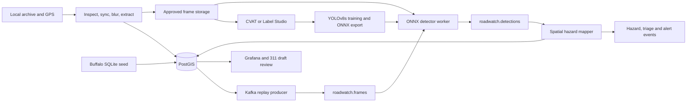

# RoadWatch Buffalo architecture

Proposed extension design. Paths describe intended responsibilities. Retain the teammate’s existing paths where review confirms they serve the same function. See [handoff-integration.md](handoff-integration.md) for the legacy stack and adapter boundary.

## Repository boundaries

| Planned path | Responsibility |
| --- | --- |
| `db/` | Reference `schema_postgis.sql`, SQLite source builder `build_database.py`, seed importer, incremental runtime migrations, spatial queries |
| `ingestion/` | `inspect_archive.py`, `ingest_drive.py`, `sample_for_labeling.py`, `replay_drive.py` |
| `mapping/` | `hazard_mapper.py`, projection and snapping, merge/lifecycle policies, triage, draft review persistence, event outbox |
| `models/` | YOLO-World bootstrapping, YOLOv8s training and evaluation, `export_onnx.py`, `detector_worker.py` |
| `infra/` | Docker Compose for Kafka, PostgreSQL/PostGIS and Grafana, pinned versions, readiness checks, topic provisioning and dashboard config |
| `schemas/` and `tests/` | Pydantic models, generated JSON Schema, prototype compatibility fixtures, and integration tests using synthetic or approved data |
| Root `Makefile` | Future targets such as `infra-up`, `db-init`, `db-seed`, `db-refresh-source`, and `test-integration` |

## Seed and persistence

The attached SQLite snapshot is the reproducible first seed. Import the seven public tables in dependency order with `sources` first, then `roads`, then `city_311_road_requests`, `city_311_potholes_hist`, `events_511ny`, `crashes_nys`, `weather_hourly`, and `bridges_erie`. Preserve `data_quality_checks` as source audit metadata (snapshot has seven warnings). Expected row counts in order for the seven tables are 6,850, 17,767, 21,337, 5,098, 32,722, 68,305, and 911.

Apply the base DDL once via a migration ledger with stop-on-error. Stage seed data transactionally, parse road GeoJSON as WGS84, construct point geometries as longitude then latitude, preserve null and placeholder flags, and expose street names via the roads join in place of SQLite’s denormalized `osm_street`. Normalize known timestamps with explicit source timezone rules. Verify counts, SRID, geometry validity, sample joins, source provenance and existing runtime references before committing. Refresh with keyed upserts and retain any road referenced by operational data. Running the attached builder against an existing SQLite path deletes it first, so build fresh data in a scratch directory, record checksum and provenance, then import explicitly. Its upstream sources are Buffalo Open Data, NY Open Data, OSM Overpass and Iowa Environmental Mesonet. Normal bootstrap can seed offline once the snapshot is available.

Plan migrations for stable observation IDs and hazard membership, per-pass evidence, drive-level split assignment, pin revisions, 311 drafts, processing receipts, and the outbox. Use indexed geography or a suitable local projected CRS for distance queries in meters. Media lives in managed files or object storage, referenced by stable IDs with worker-accessible paths. Grafana uses a read-only database role and approved assets.

## Ingestion and replay

See [data-and-model-plan.md](data-and-model-plan.md) for media intake and labeling. Replay orders persisted frames by capture PTS with a stable tiebreaker. Schedule on a monotonic clock using elapsed capture time divided by the requested rate (1×–10×). Bound outstanding sends and record lag under backpressure. Preserve original capture time and add a replay-session ID and simulated camera emission time. Separate functional/demo runs from measured runs and use isolated replay datasets or environments so repeat runs do not distort lifecycle evidence.

## Spatial merge and lifecycle

1. Interpret each box’s road contact point using calibrated intrinsics and mount height, pitch and yaw. Project a ground-plane ray into local meters and rotate it by vehicle heading. Record scale and combined uncertainty from camera geometry and GPS. Near-horizon boxes, missing heading, poor GPS or out-of-range projections are excluded from automatic pin creation and retained for diagnostics.
2. Compute estimated hazard geometry separately from the car’s geometry. Snap to a plausible nearby OSM segment using distance and, where available, route continuity and travel direction. Gate by snap quality. Preserve unsnapped estimates and flag ambiguity at parallel roads and intersections.
3. Search active pins of the same class on the same or explicitly connected segment within the configurable 12 m default. Use a deterministic nearest-match tie-breaker, a bounded pin displacement and evidence IDs to prevent chain merges and duplicate counts. Count frames, independent passes and known distinct vehicles separately. Serialize competing spatial writes, initially with one mapper writer, and commit the observation, membership, pin changes and outbox in one transaction.
4. Create a `candidate` on the first credible sighting. Confirm after configured distinct frame and independent pass/vehicle criteria. The exact policy is open until pilot calibration. Frame bursts alone do not establish independence. Expire unsupported single-frame candidates to `dropped` using event time and a documented window.
5. Resolve confirmed or reported pins after configured independent qualified clean passes since the last sighting. Require the same segment or compatible direction, adequate GPS/visibility and successful inference through the expected viewing window. Use a bounded event-time grace period for late detections and reset clean-pass evidence after a credible positive. Missing images, unresolved clocks, worker errors and unmatched frames never count as negative evidence. A fresh credible sighting at a terminal pin starts a linked new episode.
6. Rules triage confirmed pins into watch, dashboard alert or draft. Candidates can be watched without an urgent alert. For a pothole draft, look for nearby relevant 311 records on a compatible road segment (prototype starts at 30 m), prefer an existing open case and distinguish recently closed cases from no case. Persist one pending draft per hazard episode, include approved evidence and a reason, and require human review. Mark `reported` only when a real external reference is explicitly recorded.

## Reliability and measurement

Use at-least-once Kafka delivery with stable IDs, idempotent writes, retries for transient failure, and a dead-letter path for invalid messages. Inference publishes all per-frame detection batches with deterministic item IDs. Mapper commits DB effects and outbox rows before committing offsets, and dashboard/event consumers deduplicate by transition ID. For a transient worker failure, retry the input and expose lag. For a permanent inference failure, publish a terminal failed frame outcome so the pass evaluator has explicit coverage information.

Track ingest/sync coverage, decode and privacy failures, Kafka lag and retries, worker timing and throughput, snap rejection, merge ambiguity, pass evidence, and counts by pin state. Camera-to-pin is committed pin timestamp minus replay frame emission timestamp on synchronized clocks. Record original capture time for provenance. Camera-to-alert adds the time until dashboard alert publication. Report warmup, percentiles, workload, dropped/failed frames, confirmation policy, and behavior at both real-time and accelerated replay.

## Attachment roles

The prototype is the wire-format and UI reference and contains a simulated drive. The slide deck describes earlier work, ownership, metrics and options. The database dashboard and `export_dashboard.py` illustrate a static SQLite-based view. Use their display and query ideas for Grafana after the runtime tables exist. The attached database README documents the source snapshot and local builder. The current repository is a README-only starting point.
